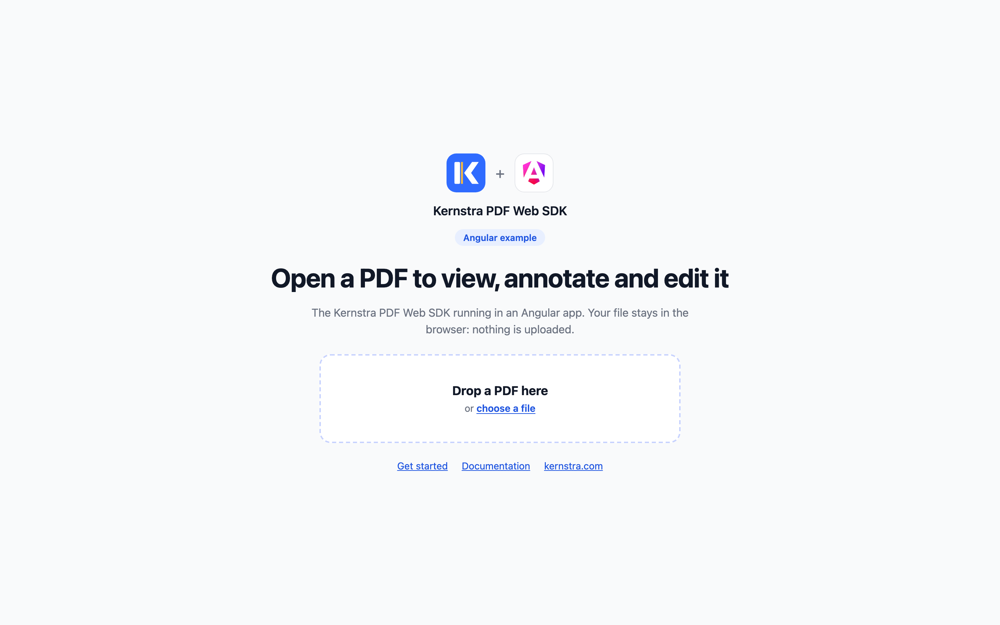
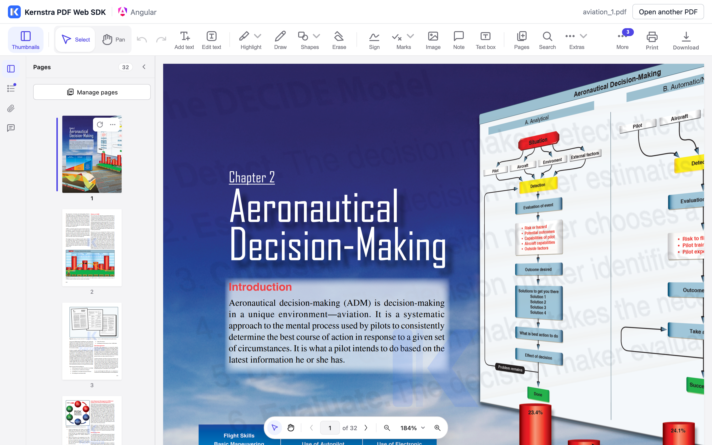

# Kernstra PDF Web SDK: Angular example

View, annotate, edit and fill PDFs in an Angular app with the
[Kernstra PDF Web SDK](https://kernstra.com/web-sdk) (`@kernstra/pdf-web-sdk` on npm). The document is rendered and changed entirely in
the browser; nothing you open leaves it.

New to the SDK? The [get-started guide](https://kernstra.com/web-sdk/get-started) goes from
`npm install` to a first PDF, and the [playground](https://kernstra.com/playground) opens your own
PDF without installing anything.

<p>
  
  
</p>

Built with Angular 22 (standalone components, zoneless, signals).

## What it shows

- Starting the SDK once, from an injectable service (`src/app/kernstra.service.ts`)
- A Kernstra-branded landing page that takes a PDF from the file picker or a drop; the file stays in the browser
- A `DocumentViewer` component that opens the file in `afterRenderEffect` (browser only) and releases it in the effect's cleanup
- Loading the viewer in a `@defer` block: its chunk, and the SDK with it, loads when the first PDF is chosen and stays out of the initial bundle

## Requirements

- Node.js 22.22.3 or later (or 24.15+)
- A Kernstra license key

## 1. Get a license key

The SDK does not start without a license key. Sign in to the
[Kernstra console](https://console.kernstra.com) and copy a **development key**: it
runs on any host, `localhost` included, and watermarks every page. A **production
key** renders clean pages and runs only on the domains it names.

The key is not a secret. It ships to the browser by design: the SDK verifies it
there. See [Licensing](https://kernstra.com/docs/web-sdk/guides/licensing).

## 2. Run it

```bash
npm install
cp .env.example .env.local   # then paste your key after KERNSTRA_LICENSE=
npm start
```

Open http://localhost:4200 and drop a PDF on the page, or choose one: the SDK loads once you do.

The Angular CLI does not read `.env` files: `npm start` and `npm run build` go through `scripts/ng.mjs`, which reads `KERNSTRA_LICENSE` from your environment or `.env.local` and passes it as `ng serve --define "KERNSTRA_LICENSE='…'"`. Running `ng serve` directly skips that step, so use the npm scripts.

## Where the SDK is wired in

| File | What it does |
| --- | --- |
| `src/app/kernstra.service.ts` | Owns the SDK options and calls `Kernstra.init()` with the key from `environment` |
| `src/app/pdf-dropzone.ts` | The landing page: file picker and drop target |
| `src/app/document-viewer.ts` | Opens the file with `PDFDocument.fromFile()`, builds the `PDFViewer`, destroys both on destroy or a new `file` |
| `src/app/app.ts`, `app.html` | Holds the chosen file in a signal: the landing page without one, the header and the deferred viewer with one |
| `src/environments/*.ts` | `environment.kernstraLicense`, filled at build time with `--define` |
| `scripts/ng.mjs` | Runs the Angular CLI with `--define "KERNSTRA_LICENSE=…"`, from your environment or `.env.local` |

## Build for production

```bash
npm run build
# serve dist/pdf-web-sdk-example-angular/browser with any static server,
# for example: npx serve dist/pdf-web-sdk-example-angular/browser
```

The key is written into the bundle when it builds, so set it before `npm run build`.

Serve it over HTTPS: the license check needs the browser's Web Crypto API, which
exists only in a secure context (`localhost` counts as one).

## Learn more

- [Kernstra PDF Web SDK](https://kernstra.com/web-sdk): what the SDK does, the tools it ships and pricing
- [Get started](https://kernstra.com/web-sdk/get-started): from `npm install` to an embedded PDF viewer
- [Angular integration guide](https://kernstra.com/docs/web-sdk/guides/integrations#s-angular): the component this example is built from
- [Documentation](https://kernstra.com/docs/web-sdk): every configuration option, the programmatic API, events and errors
- [`@kernstra/pdf-web-sdk` on npm](https://www.npmjs.com/package/@kernstra/pdf-web-sdk)
- Support: [support@kernstra.com](mailto:support@kernstra.com)

## Other frameworks

The same page, built with:

- [Vanilla TypeScript](https://github.com/kernstra/pdf-web-sdk-example-vanilla)
- [React](https://github.com/kernstra/pdf-web-sdk-example-react)
- [Next.js](https://github.com/kernstra/pdf-web-sdk-example-nextjs)
- [Vue](https://github.com/kernstra/pdf-web-sdk-example-vue)
- [Nuxt](https://github.com/kernstra/pdf-web-sdk-example-nuxt)
- [Svelte](https://github.com/kernstra/pdf-web-sdk-example-svelte)
- [SvelteKit](https://github.com/kernstra/pdf-web-sdk-example-sveltekit)

## License

The example code is released under the [MIT License](LICENSE). The Kernstra PDF Web
SDK it uses is commercial software, governed by its
[license agreement](https://kernstra.com/legal/web-sdk-license-terms).

Built and maintained by [Kernstra](https://kernstra.com/).
